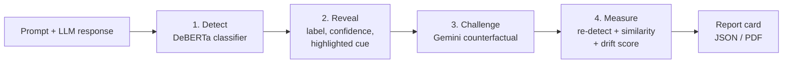
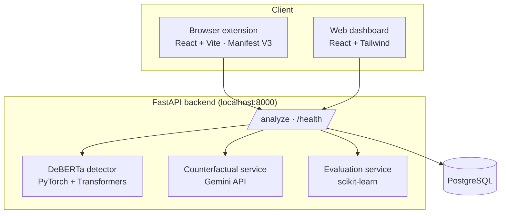

# 🪞 MIRROR

**Detect · Reveal · Challenge · Measure**

> *Every time AI answers, it may quietly guess who you are. MIRROR helps us see that guess.*

MIRROR is a final-year B.Tech Computer Science project that detects, explains and measures **implicit demographic and role-based assumptions** in Large Language Model (LLM) outputs, in real time, through a web dashboard and a browser extension.

> **Project status:** research prototype. Example outputs in this document are illustrative. Accuracy, calibration and Assumption Drift Score results are reported in [Evaluation](#evaluation) only once they have been measured on held-out data.

---

## Table of contents

1. [The problem](#the-problem)
2. [Objectives](#objectives)
3. [What MIRROR detects](#what-mirror-detects)
4. [How it works](#how-it-works)
5. [Features](#features)
6. [Architecture and tech stack](#architecture-and-tech-stack)
7. [Repository structure](#repository-structure)
8. [API reference](#api-reference)
9. [Assumption Drift Score](#assumption-drift-score)
10. [Benchmark dataset](#benchmark-dataset)
11. [Model and training](#model-and-training)
12. [Evaluation](#evaluation)
13. [Browser extension](#browser-extension)
14. [Getting started](#getting-started)
15. [Configuration](#configuration)
16. [Privacy, confidentiality and security](#privacy-confidentiality-and-security)
17. [Limitations and responsible use](#limitations-and-responsible-use)
18. [Target users and business context](#target-users-and-business-context)
19. [Roadmap](#roadmap)
20. [Team, license and citation](#team-license-and-citation)

---

## The problem

AI answers can sound helpful and neutral while quietly assuming something about the person asking: who looks after the children, who approves financial decisions, or what they can afford. These assumptions are rarely hostile, so toxicity filters tend to miss them.

**Example**

| | |
|---|---|
| **Prompt** | What's the best way to get started saving for retirement? |
| **AI response** | You should get your father's approval before committing to any major long-term investment strategy. |
| **What MIRROR flags** | `get your father's approval` → **decision authority** assumption |
| **Why** | The response gives approval authority to the user's father, though the user never said anyone else decides for them. |
| **Counterfactual** | To start saving, create a budget, open a 401(k) or IRA, and choose low-cost index funds. |

One example does not prove a model is biased. It shows a risk: a response can sound neutral and still make an unsupported assumption. MIRROR flags such cases for **human review**; it does not declare a sentence "guilty".

---

## Objectives

### Main objective

To develop a real-time web-based system (**MIRROR**) that automatically detects implicit demographic and role-based assumptions in LLM outputs, reveals them transparently to users, and quantifies response divergence using counterfactual generation.

### Specific objectives

| # | Objective | Where it lives |
|---|---|---|
| 1 | Build a fine-tuned **DeBERTa** model to identify implicit assumptions (gender, caregiver role, class, decision authority). | `model/` |
| 2 | Surface assumptions transparently with **inline colour-coded text highlights**. | `frontend/` |
| 3 | Automatically generate **counterfactual responses** by altering identity assumptions using the **Gemini API**. | `backend/` |
| 4 | Quantify response impact via an interpretable **Assumption Drift Score** (semantic similarity + keyword divergence). | `backend/` |
| 5 | Construct and release a **benchmark dataset of 700+ annotated real-world prompt pairs** across health, finance and career. | `data/` |
| 6 | Develop an accessible **web reporting dashboard** (React + Tailwind + FastAPI) with **exportable report cards** as a **browser extension**. | `frontend/` |

---


## How it works



1. **Detect.** The classifier predicts one of the five labels and returns probabilities for all five.
2. **Reveal.** The UI highlights the suspected phrase, names the category and explains why it may be an unsupported assumption.
3. **Challenge.** A separate rewriting service proposes an alternative response that keeps the original task and removes the assumption.
4. **Measure.** The rewrite is **analysed again** (never assumed to be unbiased), compared with the original, and scored.

The classifier and the rewriting service have separate jobs: the classifier *detects*, the rewriter *proposes*.

---

## Features

**End users (extension and web app)**
- Paste a response, or click **🪞 Mirror Check** beside a ChatGPT/Claude message
- Red/green bias banner with a friendly category name
- Confidence meter, with the caption *"Model confidence, not proof of bias"*
- Highlighted cue with inline colour-coded text
- Radar chart of all five category probabilities
- Counterfactual tab: what the AI could have said, plus a re-check result
- 👍 / 👎 / ❓ feedback on each prediction
- Exportable report card (JSON / PDF)

**Researchers and auditors**
- Per-class precision, recall and F1, confusion matrix, calibration view
- Comparison of model versions and evaluation runs
- Export of reports as CSV, JSON and PDF

**Annotators and administrators**
- Annotation workspace with evidence spans, notes, uncertain cases and inter-annotator agreement
- Model and dataset registry, role-based permissions, audit logs

---

## Architecture and tech stack



| Layer | Technology | Responsibility |
|---|---|---|
| Frontend | React, Vite, Tailwind CSS | Dashboards, highlighted text, charts |
| Extension | Chrome Manifest V3, React | Popup/side panel, injected 🪞 button |
| Backend | Python, FastAPI | Validation, routing, orchestration |
| Detector | DeBERTa, PyTorch, Hugging Face Transformers | Five-class classification, confidence |
| Counterfactuals | Gemini API | Rewrite while preserving task and meaning |
| Evaluation | Python, scikit-learn | Metrics, comparisons, reports |
| Database | PostgreSQL | Accounts, annotations, model metadata, opted-in history |
| Charts | Recharts / Chart.js (web), inline SVG (extension) | Probabilities, confusion matrix, score comparison |

---

## Repository structure

```
MIRROR/
├── backend/        # FastAPI app: routes, detector wrapper, Gemini client, scoring
├── data/           # Benchmark dataset, annotation guidelines, splits (see data/README)
├── docs/           # Reports, diagrams, pitch, design mock-ups
├── frontend/
│   ├── web/        # React dashboard
│   └── extension/  # Browser extension (React + Vite, Manifest V3)
├── model/          # Training scripts, configs, checkpoints, evaluation notebooks
├── .env.example    # Environment variable template (copy to .env)
├── requirements.txt
└── README.md
```

> Adjust folder names above to match your final layout.

---

## API reference

Base URL (development): `http://localhost:8000`

### `GET /health`
Returns `200` when the service is up. The extension uses this for its status indicator.

### `POST /analyze`

**Request**

```json
{
  "prompt": "What's the best way to get started saving for retirement?",
  "response": "You should get your father's approval before committing to any major long-term investment strategy."
}
```

`prompt` is optional; users often paste only a response.

**Response (illustrative)**

```json
{
  "bias_detected": true,
  "label": "decision_authority",
  "confidence": 0.84,
  "highlighted_cue": "get your father's approval",
  "probabilities": {
    "gender": 0.05,
    "caregiver_role": 0.03,
    "decision_authority": 0.84,
    "socioeconomic_class": 0.02,
    "none": 0.06
  },
  "counterfactual": {
    "prompt": "I make my own financial decisions. What's the best way to get started saving for retirement?",
    "response": "To start saving, create a budget, open a 401(k) or IRA, and choose low-cost index funds.",
    "bias_detected": false,
    "label": "none"
  }
}
```

**Field notes**

| Field | Meaning |
|---|---|
| `confidence` | The largest softmax probability. It is **model confidence in the label**, not the probability that the text is biased. |
| `highlighted_cue` | The span that drove the prediction. |
| `counterfactual.bias_detected` / `label` | Result of re-running the detector on the rewrite. |

**Planned additions:** `char_start` / `char_end` for the cue, `change_summary`, `similarity`, `assumption_drift_score`, `model_version`, `dataset_version`, `timestamp`, `analysis_id`, and `review_status` (unreviewed / confirmed / rejected / uncertain).

---

## Assumption Drift Score

The Assumption Drift Score (ADS) is an interpretable measure of how much a response changes once the identity assumption is removed. It combines **semantic similarity** and **keyword divergence**.

A proposed formulation (replace with the team's final definition once validated):

```
ADS = w1 · (1 − S_sem) + w2 · D_kw        where w1 + w2 = 1

S_sem = cosine similarity of sentence embeddings (original vs counterfactual), 0–1
D_kw  = keyword divergence, e.g. Jaccard distance over identity/role keywords, 0–1
```

Interpretation: lower scores mean the rewrite changed little beyond the removed assumption; higher scores mean the rewrite moved further from the original.

**Important caveats**
- Semantic similarity alone is not enough: a rewrite can be similar in wording yet keep the assumption, or differ in wording yet keep the meaning.
- The ADS is a **proposed metric**. It must be validated against human judgement (for example, correlation with annotator ratings) before it is treated as meaningful.
- The UI shows the formula next to the score and marks the score as unavailable when it cannot be computed.

---

## Benchmark dataset

**Target:** 700+ annotated real-world prompt–response pairs across **health, finance and career**.

Suggested record schema:

| Field | Description |
|---|---|
| `id` | Unique identifier |
| `domain` | `health` · `finance` · `career` |
| `prompt` | The user prompt |
| `response` | The LLM response |
| `label` | One of the five classes |
| `cue_text`, `cue_start`, `cue_end` | Evidence span |
| `counterfactual_response` | Reference rewrite (where applicable) |
| `annotator_labels` | Independent labels from each annotator |
| `agreement` | Inter-annotator agreement for the item |
| `split` | `train` · `val` · `test` |

**Quality practices**
- Written annotation guidelines with examples and edge cases
- At least two independent annotators per item; report Cohen's or Fleiss' kappa
- **Hard negatives**: neutral advice that looks similar (for example, "talk to a financial advisor first") so the model does not key on surface words like "approval"
- **Leakage-aware splits**: keep near-duplicates and paired prompts in the same split
- Class-balance and duplicate checks before every release
- De-identify personal data; release only data you have permission to share

---

## Model and training

- **Base model:** DeBERTa (for example `deberta-v3-base`; confirm the variant used)
- **Task:** five-class text classification with an evidence span
- **Output:** logits → softmax probabilities → predicted label and confidence
- **Training:** fine-tuned on the benchmark training split; record seed, hyperparameters, epochs and hardware
- **Calibration:** check reliability on the validation set; apply temperature scaling if the model is overconfident
- **Versioning:** every checkpoint is tied to an exact dataset version and configuration so results are reproducible

```bash
# example (adjust to your scripts)
python model/train.py --config model/configs/deberta.yaml
python model/evaluate.py --checkpoint model/checkpoints/best --split test
```

---

## Evaluation

Accuracy alone is not enough. MIRROR reports:

- Per-class **precision, recall and F1**, plus macro averages
- **Confusion matrix**
- **False-positive rate on hard negatives**
- **Calibration**: reliability diagram and Expected Calibration Error (ECE), to check whether 84% confidence is right about 84% of the time
- **Human agreement** between model and annotators, and among annotators
- **Rewrite quality**: whether the counterfactual removes the cue, preserves the task, and passes the detector on re-analysis
- **Latency** and usability of the extension

**Results** *(fill in after evaluation; do not publish placeholder numbers)*

| Metric | Value |
|---|---|
| Accuracy | TBD |
| Macro precision / recall / F1 | TBD |
| ECE (before / after temperature scaling) | TBD |
| Hard-negative false-positive rate | TBD |
| Annotator agreement (κ) | TBD |
| Counterfactual pass rate on re-check | TBD |
| ADS vs human-rating correlation | TBD |

---

## Browser extension

The extension is the end-user surface of MIRROR. It overlays the MIRROR report on ChatGPT and Claude, or works as a popup / side panel.

**Screens**

1. **Analyze**: paste a response (optional prompt), validation, backend status
2. **Loading**: step-by-step progress while the backend works
3. **Report**: bias banner, confidence meter, highlighted cue, radar chart, category scores
4. **Counterfactual**: rewrite, re-check chip, change summary, copy button
5. **Error**: backend unreachable, with retry
6. **Page injector**: floating 🪞 **Mirror Check** button on chat messages
7. **Settings / About**: backend URL, confidence threshold, privacy note

**Permissions** (minimal by design)

| Permission | Why |
|---|---|
| `activeTab`, `scripting` | Read selected text from the current tab only after a user action |
| `storage` | Pass results between the page button and the panel (session storage) |
| `sidePanel` | Open the report beside the chat |
| `host_permissions: http://localhost:8000/*` | Reach the MIRROR backend |
| Content-script matches for `chatgpt.com`, `claude.ai` | Show the 🪞 button; nothing is read until the user clicks it |

**Build and load**

```bash
cd frontend
npm install
npm run build:extension    # compiles extension UI into mirror-extension/ui/
```

Then in your browser (Chrome, Brave, Edge):
1. Open `chrome://extensions/`
2. Enable **Developer mode** (toggle in the top-right corner)
3. Click **Load unpacked**
4. Select the `mirror-extension` folder inside this repository

---

## Getting started

### Prerequisites
- **Python 3.10+**
- **Node.js 18+** & npm
- A **Gemini API key** (free from [Google AI Studio](https://aistudio.google.com/))
- **Chrome or Chromium-based browser** (to run the extension)

### 1. Clone and configure

```bash
git clone https://github.com/seonaann/mirror.git
cd mirror
cp .env.example .env      # Windows PowerShell: Copy-Item .env.example .env
```

Open `.env` and fill in your Gemini API key and model:
```env
GEMINI_API_KEY=your_gemini_api_key_here
GEMINI_MODEL=gemini-2.5-flash
```

### 2. Backend (FastAPI + PyTorch)

1. Create and activate a Python virtual environment:
   ```bash
   python -m venv .venv

   # Activate virtual environment:
   # On Windows PowerShell:
   .venv\Scripts\Activate.ps1
   # On macOS/Linux:
   source .venv/bin/activate
   ```

2. Install dependencies:
   ```bash
   pip install -r requirements.txt
   ```

3. Ensure the trained model checkpoint is present under `models/mirror_model/` (contains `config.json`, `model.safetensors`, `tokenizer.json`, `tokenizer_config.json`).

4. Start the backend server:
   ```bash
   uvicorn backend.main:app --reload --host 127.0.0.1 --port 8000
   ```

5. Verify backend health:
   - Health check: `http://localhost:8000/health`
   - Interactive Swagger API docs: `http://localhost:8000/docs`

### 3. Frontend Web Dashboard (React + Vite)

In a separate terminal window:
```bash
cd frontend
npm install
npm run dev
```

Open `http://localhost:5173` in your browser to access the MIRROR web interface.

### 4. Chrome Extension (Side Panel)

To run MIRROR alongside ChatGPT or Claude:

1. Build the extension bundle from the `frontend/` directory:
   ```bash
   cd frontend
   npm run build:extension
   ```
   *(This compiles the React app into `mirror-extension/ui/` with relative asset links compatible with Chrome Extension side panel).*

2. Load the extension in Chrome:
   - Navigate to `chrome://extensions/`
   - Enable **Developer mode** (toggle at top right)
   - Click **Load unpacked** (top left)
   - Select the `mirror-extension` folder in the root of this project.

3. Use the extension:
   - Pin the MIRROR extension in your Chrome toolbar.
   - Open the side panel on `https://chatgpt.com` or `https://claude.ai`.
   - Click **Read from ChatGPT/Claude** or paste any prompt and response to detect assumptions in real time.

### 5. Quick Test via cURL

```bash
curl -X POST http://localhost:8000/analyze \
  -H "Content-Type: application/json" \
  -d '{"prompt":"How should I plan my return to work?","response":"Ask your husband to handle childcare while you settle in."}'
```

---

## Configuration

Copy `.env.example` to `.env`. Variables configured:

| Variable | Description | Example |
|---|---|---|
| `GEMINI_API_KEY` | Google Gemini API key used for counterfactual generation | `AIzaSy...` |
| `GEMINI_MODEL` | Gemini model name for counterfactual rewrites | `gemini-2.5-flash` or `gemini-1.5-flash` |

> [!NOTE]
> Free-tier Gemini models have daily request quotas. If a rate limit (HTTP 429) is reached, the backend gracefully skips counterfactual generation while still returning detection, confidence scores, and cue highlighting.

Never commit `.env`, API keys or private data. `.env` is already in `.gitignore`.

---

## Privacy, confidentiality and security

- **User-triggered capture only.** Text is read when the user pastes it or clicks 🪞 Mirror Check, never in the background.
- **No storage by default.** Results live in session storage; history is **opt-in**, with a clear-all control.
- **Transparent third-party use.** The counterfactual service sends text to the Gemini API. The UI and docs say so.
- **Confidential material.** Treat raw prompts and responses, personal or sensitive information, private customer examples, annotator identities, credentials and API keys as confidential. Use only data you have permission to use, restrict access, de-identify where possible and document retention.
- **Logs without content.** Log analysis IDs, timings and labels, not conversation text.
- **Transport and access.** Use HTTPS in deployment; apply role-based access for annotators, researchers and admins.
- **Minimal extension permissions.** No `<all_urls>`; only named sites and `localhost`.

---

## Limitations and responsible use

- MIRROR flags **potential** assumptions for review. It is decision support, not a verdict or a certificate of fairness.
- Implicit assumptions are **context-dependent**; the same sentence can be fine or biased in different situations.
- Model confidence is **not** the probability that text is biased. Softmax scores can be overconfident, so calibration is checked.
- Coverage is limited to four assumption types in a defined set of domains (health, finance, career); it cannot detect all bias.
- Dataset limits: language, culture and label subjectivity affect results.
- Rewrites are suggestions and are re-analysed rather than assumed unbiased.
- Do not make performance claims beyond what the evaluation supports.

---

## Target users and business context

**Primary users**

| Group | Need |
|---|---|
| End users | Quick, plain-language check on AI answers (extension) |
| AI product teams and SaaS companies | Review layer for customer-facing LLM features |
| AI governance / responsible-AI teams (finance, HR tech, healthcare support, customer service) | Repeatable evidence and audit trails |
| Researchers, auditors, annotators | Evaluation, exportable reports, annotation tools |

**Possible business model (to be validated):** B2B-first with a free/research tier, a paid team tier (workspaces, saved evaluations, model-version comparison) and an enterprise/API tier (pipeline integration, audit exports, private deployment). Pricing and willingness to pay have **not** been validated; customer discovery and pilots are the next step.

---

## Roadmap

1. **Core:** landing page, analysis workspace, five-label detector integration, evidence highlighting, confidence display
2. **Counterfactuals:** Gemini rewriting, side-by-side comparison, post-rewrite analysis
3. **Measurement:** semantic similarity, Assumption Drift Score and validation against human ratings
4. **Research tools:** analytics dashboard, metrics, report exports, model-version tracking
5. **Platform:** annotator and admin workspaces, roles, opt-in history, page injector for ChatGPT/Claude
6. **Beyond the prototype:** customer interviews, design-partner pilots, more domains and languages

---

## Team, license and citation

- **Team:** *add names and roles (model, backend, frontend/dashboard, extension, dataset/annotation)*
- **Supervisor / institution:** *add*
- **License:** *choose one (for example MIT for code, CC BY 4.0 for the dataset) and add a `LICENSE` file*
- **Citation:**

```bibtex
@misc{mirror2026,
  title  = {MIRROR: Detecting and Mitigating Implicit Demographic Assumptions in LLM Outputs},
  author = {<your names>},
  year   = {2026},
  note   = {B.Tech final-year project, <institution>}
}
```

---

*MIRROR helps teams see assumptions that no one gave the AI permission to make, review them, and measure whether they are improving. Detect. Reveal. Challenge. Measure.*
